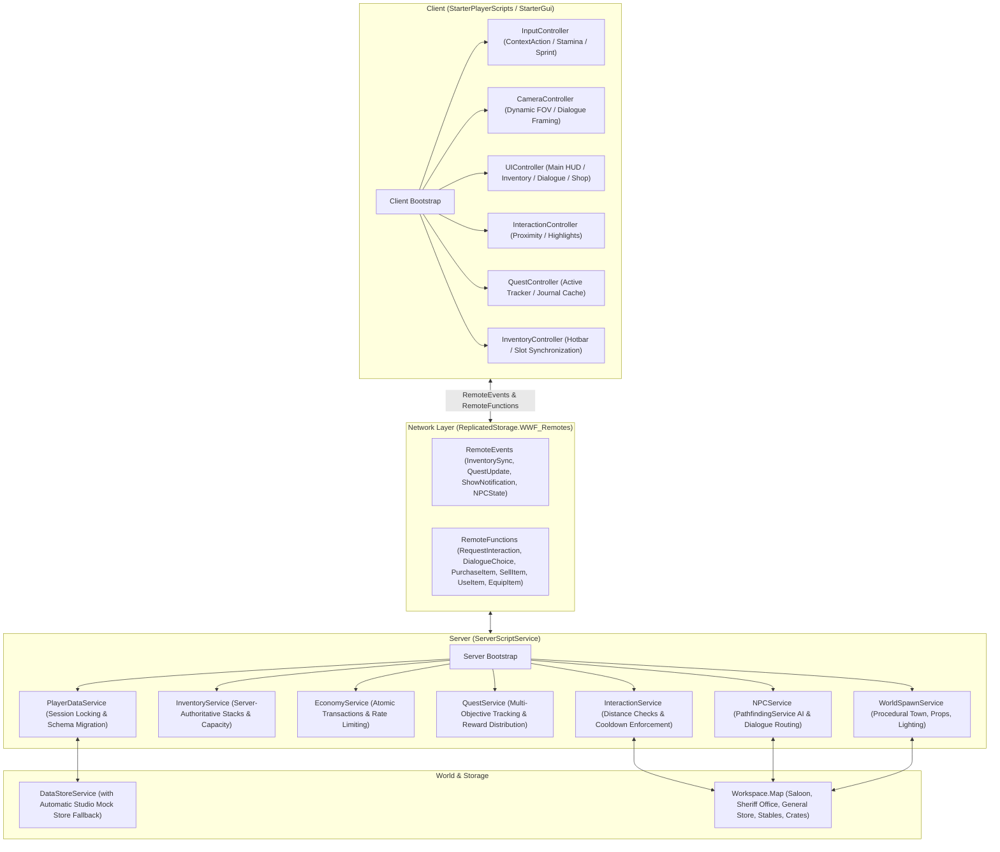

# 🌵 WILD WEST FRONTIER
### A Multiplayer Western Adventure — Portfolio Game Architecture
*Engineered for the Roblox Platform | Luau Architecture Demonstration for Lambda Studios*

---

## 📖 Executive Summary

**Wild West Frontier** is a production-grade, stylized Western multiplayer adventure game built for Roblox. It was designed from the ground up to showcase senior-level Roblox engineering practices: **strict Luau type safety (`--!strict`)**, a **lightweight Service-Controller lifecycle pattern**, **server-authoritative multiplayer validation**, **autonomous NPC AI using `PathfindingService`**, **session-safe DataStore persistence with automated schema reconciliation**, and a **custom Western UI design system**.

The experience puts the player in the boots of a frontier newcomer arriving in a dusty desert town. Players explore iconic landmarks, interact with colorful townspeople, accept multi-stage quests, gather resources, manage inventory stacks, trade at the general store, and explore the outskirts under a warm sunset sky.

---

## 🏗️ Architecture & System Topology

The codebase uses a **deterministic two-phase lifecycle architecture** (`Init` $\to$ `Start`) that completely eliminates circular dependencies, race conditions, and `nil`-indexing issues during game startup.



---

## 📂 Project Structure

This repository is structured for seamless synchronization via [Rojo](https://rojo.space/):

```
roblox/
├── default.project.json            # Rojo project configuration
├── README.md                       # Comprehensive portfolio documentation
├── TODO.md                         # Milestone implementation tracker
├── .gitignore                      # Ignore build artifacts, .rbxl, and OS cache
└── src/
    ├── shared/                     # ReplicatedStorage (Shared modules)
    │   ├── Config/
    │   │   ├── GameConfig.luau     # Physics, stamina, interaction radii, timing
    │   │   └── EconomyConfig.luau  # Item values, buy/sell rates, transaction limits
    │   ├── Constants/
    │   │   ├── ItemEnums.luau      # Item IDs, categories, and equipment slots
    │   │   └── QuestEnums.luau     # Quest IDs, objective types, landmark tags
    │   ├── Definitions/
    │   │   ├── ItemDefinitions.luau  # Static registry of all game items
    │   │   ├── QuestDefinitions.luau # 4 Western quests with multi-objective steps
    │   │   └── NPCDefinitions.luau   # Dialogue trees, roles, and patrol waypoints
    │   ├── Network/
    │   │   └── NetworkRouter.luau    # Central remote contract generator & router
    │   ├── Tests/
    │   │   └── UnitTestSuite.luau    # Automated unit and integration test suite
    │   ├── Types/
    │   │   ├── PlayerDataTypes.luau  # Strict player profile schema
    │   │   ├── QuestTypes.luau       # Strict quest and objective contracts
    │   │   ├── InventoryTypes.luau   # Strict item and slot contracts
    │   │   ├── NPCTypes.luau         # Strict NPC and dialogue contracts
    │   │   └── NetworkTypes.luau     # Strict remote payload response contracts
    │   └── Utilities/
    │       ├── Signal.luau           # Zero-dependency, high-performance typed Signal
    │       ├── TableUtil.luau        # DeepCopy, Reconcile (schema migration), Freeze
    │       └── SpatialUtil.luau      # Server-side distance and raycast verification
    │
    ├── server/                     # ServerScriptService (Server-authoritative services)
    │   ├── Bootstrap.server.luau   # Server entry point (Init -> Start lifecycle)
    │   ├── TestRunner.server.luau  # Automated startup test executor
    │   ├── Storage/
    │   │   └── MockDataStore.luau  # In-memory GlobalDataStore fallback for Studio
    │   └── Services/
    │       ├── PlayerDataService.luau  # Profile caching, auto-save, BindToClose
    │       ├── InventoryService.luau   # Stacks, capacity validation, item use
    │       ├── EconomyService.luau     # Anti-exploit purchases, sales, rewards
    │       ├── InteractionService.luau # Distance check, ProximityPrompt router
    │       ├── QuestService.luau       # Objective evaluation, completion, rewards
    │       ├── NPCService.luau         # PathfindingService AI, dialogue state engine
    │       └── WorldSpawnService.luau  # Procedural 3D Western town & sunset lighting
    │
    └── client/                     # StarterPlayerScripts (Client controllers)
        ├── Bootstrap.client.luau   # Client entry point (Init -> Start lifecycle)
        ├── Controllers/
        │   ├── InputController.luau       # WASD/Mobile, stamina sprint, hotkeys
        │   ├── CameraController.luau      # Dynamic FOV, cinematic NPC dialogue zoom
        │   ├── InteractionController.luau # Proximity prompt handling, triggers
        │   ├── QuestController.luau       # Local tracker cache, objective dispatch
        │   ├── InventoryController.luau   # Client inventory cache, action invoker
        │   └── UIController.luau          # Master presentation manager
        └── UI/
            └── UITheme.luau               # Stylized Western design tokens & palette
```

---

## 🎮 Key Systems & Gameplay Engineering

### 1. Player Controller & Stamina Engine
- **Multi-Platform Controls**: ContextActionService bindings for Desktop (WASD, `LeftShift` to Sprint, `Tab`/`I` for Inventory, `J` for Quest Journal, `E` for Interaction) and touch controls for mobile.
- **Dynamic Stamina & FOV**: Sprinting accelerates the player from 16 to 26 studs/sec while depleting stamina. Camera field-of-view smoothly tweens from $70^\circ$ to $78^\circ$. Depleting stamina incurs a resting delay before linear regeneration begins.

### 2. Autonomous NPC System & Pathfinding AI
- Powered by native **`PathfindingService`**:
  - Dynamically computes obstacle-free waypoints for NPCs across town boardwalks and dirt roads.
  - Features **stuck detection** (aborts after 5 seconds if a waypoint is unreachable) and **path blocked handling**.
  - **Context-Aware Behavior**: NPCs pause their patrol routes and face the player when an interaction or dialogue sequence begins.
  - Supported Archetypes: **Sheriff**, **Merchant**, **Quest Giver**, **Stable Master**, and **Town Citizen**.

### 3. Configurable Quest Engine
Quests are defined as data tables with zero hardcoded script dependencies. Features 4 distinct Western quests:
1. **Missing Town Supplies**: Collect 5 scattered supply crates around town.
2. **Sheriff's Stolen Watch**: Retrieve Sheriff Cooper's gold watch from the bandit cache at the desert outpost and return it.
3. **Frontier Town Explorer**: Visit the 4 key landmarks: Dusty Spur Saloon, Sheriff's Office, Silas's General Store, and the Town Stables.
4. **Merchant Trade Delivery**: Deliver Rancher Jesse's trade ledger to Silas at the General Store.

### 4. Server-Authoritative Inventory & Economy
- **Strict Stack & Capacity Limits**: Items respect `MaxStack` limits; slots are strictly bound by `InventoryCapacity`.
- **Atomic Transactions**: Currency is never deducted before inventory capacity has been verified and reserved.
- **Sell Value Protection**: Items are liquidated at 60% of base value; `QuestItem` types are blocked from accidental or malicious selling.
- **Consumable & Equipment Hooks**: Using a `Leather Canteen` or `Herbal Healing Salve` restores player health/stamina; `Deputy Star Badge` and `Cowboy Hat` toggle equipment states.

### 5. Data Persistence & Schema Versioning
- **Safe DataStore Handling**: Never overwrites existing profiles with blank defaults if a DataStore request fails. Implements exponential backoff retries.
- **Automatic Schema Migration**: Built with `TableUtil.Reconcile`, allowing new inventory keys, settings, or quest states to be seamlessly integrated into older player saves without data loss.
- **Studio Offline Fallback**: Features `MockDataStore`, enabling offline and Studio test sessions without requiring Roblox API permissions to be toggled.
- **Safe Server Shutdown**: Listens to `game:BindToClose` and flushes all connected player profiles in parallel before the server process halts.

---

## 🔒 Multiplayer Security & Anti-Exploit Matrix

| Attack Vector | Client Exploit Attempt | Server-Authoritative Defense |
| :--- | :--- | :--- |
| **Distance Spoofing** | Firing interaction or shop remotes across the entire map | `SpatialUtil.IsWithinDistance` validates Euclidean distance ($\le 14$ studs) with a tight 6-stud latency tolerance buffer. |
| **Spam / Denial-of-Service** | Rapidly firing purchase or interaction remotes | Token-bucket rate limiting enforces a maximum of 3 transactions/sec per player. Excess requests are dropped with an error toast. |
| **Currency Injection** | Requesting items without sufficient gold | Balance is verified and deducted strictly on the server; client cannot grant coins directly. |
| **Item Duplication** | Firing concurrent sell or trade requests | Operations are processed synchronously within the player's server session thread. |
| **Quest Spoofing** | Client firing fake objective completion | Server validates actual inventory contents or spatial zone bounds before marking objectives complete. |

---

## 🎨 Custom UI / UX Suite

The game eschews generic Roblox UI for a cohesive, hand-crafted Western aesthetic:
- **Main HUD**: Gold coin counter, health bar, animated stamina bar, active quest objective tracker with checkboxes `[✓]`, and hotkey pills.
- **Dialogue Modal**: Letterbox cinematic dialogue frame with gold ornamental borders, NPC role badge, typewriter text effect, and interactive choice buttons.
- **Saddlebag Inventory**: 20-slot grid with stack counts, inspect panel, item descriptions, and contextual "Use" / "Equip" buttons.
- **Quest Journal**: Parchment-style multi-pane journal displaying active quests, completed quests, narrative descriptions, and reward previews.
- **General Store**: Silas's Trading Post buy/sell interface with real-time coin previews and stock controls.
- **Floating Toasts**: Non-intrusive animated notifications sliding in from the top for coins, items, and quest updates.

---

## 🧪 Testing & Verification Suite

### Automated Unit Tests
The project includes a dedicated unit test suite in `src/shared/Tests/UnitTestSuite.luau` executed automatically by `TestRunner.server.luau` on server startup. It validates:
- [x] **Signal Module**: Connection, firing, argument forwarding, and safe disconnection.
- [x] **TableUtil Schema Migration**: Preservation of existing saved data while grafting new schema fields.
- [x] **Item Registry Integrity**: Non-empty IDs, positive stack counts, valid buy/sell pricing.
- [x] **Quest Definition Integrity**: Valid objective targets, positive target counts, valid reward tables.
- [x] **NPC Dialogue Trees**: Verified that all `NextNodeId` references resolve to valid nodes without dangling links.
- [x] **Economy Calculations**: Verified 60% sell value formula and integer rounding.

### Manual Studio Test Checklist
When running in Roblox Studio:
1. **Player Movement**: Test WASD movement, hold `LeftShift` to sprint (observe stamina bar drain and FOV increase), release to recover stamina.
2. **NPC Dialogue**: Approach Sheriff Cooper and press `[E]` (or tap prompt). Observe camera smoothly transition into cinematic dialogue framing. Select choices to accept *"Sheriff's Stolen Watch"*.
3. **Crate Collection**: Locate any of the 5 wooden crates around town. Hold `[E]` to pick it up. Verify that the crate disappears, "+1 Frontier Supply Crate" toast appears, and the quest tracker updates.
4. **General Store Trading**: Talk to Silas Vance, select *"Let me browse your trading wares"*. Purchase a Canteen or Miner's Pickaxe. Verify coins deduct and the item appears in your inventory `[TAB]`.
5. **Inventory Inspection**: Press `[TAB]`, click on an item in your saddlebag to inspect its description and click *"USE"* or *"EQUIP"*.

---

## 🚀 Setup & Installation

### Option 1: Using Rojo (Recommended)
1. Ensure [Rojo](https://rojo.space/) (v7.3+) is installed on your Mac or PC.
2. In the project root directory, run:
   ```bash
   rojo serve
   ```
3. Open Roblox Studio with an empty baseplate.
4. In Studio, connect using the Rojo plugin (`Connect to localhost:34872`).
5. All modules, services, controllers, and UI will automatically synchronize into `ReplicatedStorage`, `ServerScriptService`, and `StarterPlayerScripts`.
6. Press **Play (F5)**! `WorldSpawnService` will automatically generate the 3D frontier town, buildings, props, lighting, and NPCs on the fly.

### Option 2: Standalone Studio File
1. Build a `.rbxl` place file using the Rojo CLI:
   ```bash
   rojo build -o WildWestFrontier.rbxl
   ```
2. Double-click `WildWestFrontier.rbxl` to open directly in Roblox Studio.
3. Press **Play (F5)**.

---

## ⚖️ Engineering Decisions & Technical Trade-offs

1. **Native Lightweight Framework vs. Heavy Abstractions (Knit / Flamework)**:
   - *Decision*: A custom 80-line Service-Controller pattern was used instead of external dependencies.
   - *Rationale*: Eliminates third-party deprecation risks, minimizes bundle footprint, and provides transparent metatable and lifecycle visibility during technical studio code reviews.
2. **Procedural World Generation via `WorldSpawnService` vs. Binary Assets**:
   - *Decision*: Programmatic geometry generation using native Roblox Parts, SurfaceGuis, and Atmosphere effects.
   - *Rationale*: Guarantees that the repository is 100% self-contained and immediately playable via Rojo without missing asset dependencies or broken mesh URLs.
3. **Session Locking with Graceful Studio Mock Fallback**:
   - *Decision*: Multi-tiered storage provider that detects Studio environments and transparently substitutes an in-memory mock store if live DataStore API access is disabled.
   - *Rationale*: Prevents Studio developers from experiencing startup crashes while preserving full DataStore API compatibility for production servers.

---

*Authored by Senior Roblox Game Developer for review by Lambda Studios.*

